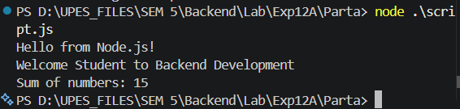
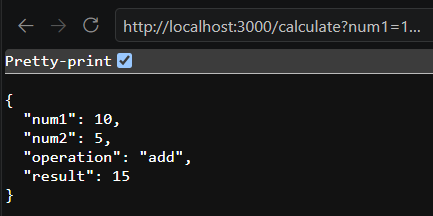
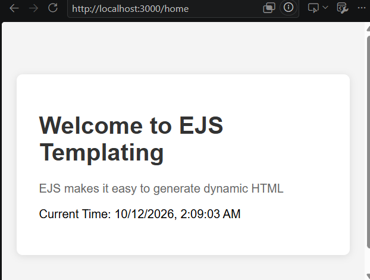
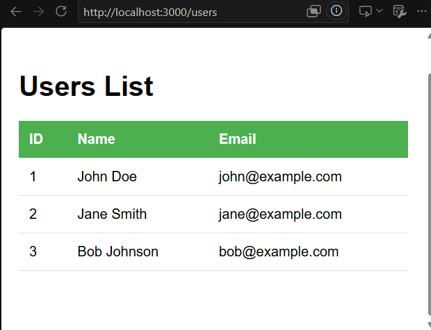
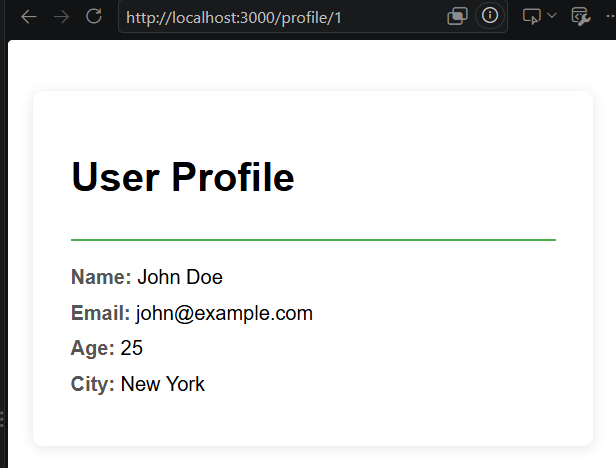

# Experiment 12A - Node.js, Express.js and EJS Templating

## Aim

To understand the fundamentals of backend development using Node.js and Express.js, handle different types of HTTP requests and responses, work with route and query parameters, process POST data, and create dynamic web pages using EJS templates.

---

## Technologies Used

- Node.js
- JavaScript
- NPM
- Express.js
- EJS
- HTML
- CSS

---

## Project Structure

```text
Exp12A/
│
├── Parta/
│   ├── app.js
│   ├── script.js
│   ├── package.json
│   └── package-lock.json
│
├── Partb/
│   ├── views/
│   │   ├── home.ejs
│   │   ├── profile.ejs
│   │   └── users.ejs
│   ├── app.js
│   ├── package.json
│   └── package-lock.json
│
├── screenshots/
│   ├── parta-node-output.png
│   ├── parta-json-response.png
│   ├── partb-calculator.png
│   ├── partb-home.png
│   ├── partb-users.png
│   └── partb-profile.png
│
└── README.md
```

---

# Part A - Node.js and Express Basics

Part A introduces basic Node.js execution and the creation of a simple web server using Express.js.

## 1. Basic Node.js Script

The `script.js` file demonstrates running JavaScript using Node.js.

It includes:

- Printing messages to the console
- Working with variables
- Template literals
- Arrays
- Using `reduce()` to calculate the sum of array elements

Run the script using:

```bash
node script.js
```

Example output:

```text
Hello from Node.js!
Welcome Student to Backend Development
Sum of numbers: 15
```

---

## 2. Express Server

The `app.js` file creates an Express server running on port `3000`.

Run the server using:

```bash
node app.js
```

The application will be available at:

```text
http://localhost:3000
```

---

## Part A Routes

| Method | Route | Description |
|---|---|---|
| GET | `/` | Sends a welcome message |
| GET | `/text` | Sends a plain text response |
| GET | `/html` | Sends an HTML response |
| GET | `/json` | Sends a JSON response |
| GET | `/status` | Sends a JSON response with HTTP status code 201 |

---

## Express Response Methods Used

### `res.send()`

Used to send text and HTML responses.

```javascript
res.send('Welcome to Express!');
```

### `res.json()`

Used to send JSON responses.

```javascript
res.json({
    message: 'This is JSON response',
    status: 'success'
});
```

### `res.status()`

Used to set an HTTP status code before sending the response.

```javascript
res.status(201).json({
    message: 'Created successfully'
});
```

---

# Part B - Express Routing, POST Data and EJS

Part B extends the Express application by introducing:

- Express middleware
- Route parameters
- Query parameters
- POST requests
- Request body handling
- EJS templates
- Dynamic data rendering

---

## Express Middleware

The following middleware is used to process incoming request data:

```javascript
app.use(express.json());
app.use(express.urlencoded({ extended: true }));
```

`express.json()` handles JSON request bodies, while `express.urlencoded()` handles URL-encoded form data.

---

## EJS Configuration

EJS is configured as the template engine:

```javascript
app.set('view engine', 'ejs');
app.set('views', './views');
```

The EJS templates are stored inside:

```text
Partb/views/
```

---

# Part B Routes

| Method | Route | Description |
|---|---|---|
| GET | `/` | Displays the Express welcome message |
| GET | `/text` | Returns plain text |
| GET | `/html` | Returns HTML |
| GET | `/json` | Returns a JSON response |
| GET | `/user/:id` | Demonstrates route parameters |
| GET | `/search` | Demonstrates query parameters |
| GET | `/calculate` | Performs calculator operations |
| POST | `/register` | Handles user registration data |
| POST | `/login` | Demonstrates login handling |
| GET | `/home` | Renders the EJS home page |
| GET | `/users` | Renders a list of users using EJS |
| GET | `/profile/:id` | Renders a user profile using EJS |

---

# Route Parameters

The `/user/:id` route demonstrates how values can be obtained directly from the URL.

Example:

```text
GET /user/123
```

The ID is accessed using:

```javascript
req.params.id
```

Example response:

```json
{
    "message": "User details",
    "userId": "123"
}
```

---

# Query Parameters

The `/search` route demonstrates query parameters.

Example request:

```text
http://localhost:3000/search?q=nodejs&page=2&limit=20
```

The values are obtained using:

```javascript
req.query
```

If `page` and `limit` are not provided, the application uses default values of `1` and `10`.

---

# Calculator API

The `/calculate` route implements a simple calculator using query parameters.

## Supported Operations

- Addition
- Subtraction
- Multiplication
- Division

Example:

```text
http://localhost:3000/calculate?num1=10&num2=5&operation=add
```

Example response:

```json
{
    "num1": 10,
    "num2": 5,
    "operation": "add",
    "result": 15
}
```

The calculator also checks for division by zero.

---

# POST Request Handling

## Registration

The following endpoint accepts registration data:

```text
POST /register
```

The request body contains:

```json
{
    "username": "john",
    "email": "john@example.com",
    "password": "pass123"
}
```

The application reads the submitted data using:

```javascript
req.body
```

and returns a successful registration response containing the username and email.

> This experiment only demonstrates POST data handling. Registration data is not stored in a database.

---

## Login

The login endpoint is:

```text
POST /login
```

The application checks the submitted email and password against sample credentials.

Valid credentials used in the experiment:

```text
Email: test@example.com
Password: password123
```

For valid credentials, the application returns:

```json
{
    "success": true,
    "message": "Login successful",
    "token": "sample-jwt-token"
}
```

Invalid credentials return HTTP status `401`.

> The token used here is only a sample string for demonstration and is not an implemented JWT authentication system.

---

# EJS Templating

EJS is used to dynamically generate HTML pages by passing data from Express routes to templates.

Three EJS templates are implemented:

```text
views/
├── home.ejs
├── profile.ejs
└── users.ejs
```

---

## Home Page

Route:

```text
GET /home
```

The Express route passes:

- Page title
- Heading
- Message

to `home.ejs`.

The template displays these values dynamically using EJS syntax.

It also displays the current date and time.

Example:

```ejs
<h1><%= heading %></h1>
<p><%= message %></p>
```

---

## Users List

Route:

```text
GET /users
```

The application contains sample user data:

```text
John Doe
Jane Smith
Bob Johnson
```

This array is passed from Express to `users.ejs`.

The template loops through the users and displays:

- ID
- Name
- Email

in an HTML table.

The EJS loop used is:

```ejs
<% users.forEach(function(user) { %>

    <%= user.id %>
    <%= user.name %>
    <%= user.email %>

<% }); %>
```

The template also displays `No users found.` if the user array is empty.

---

## User Profile

Route:

```text
GET /profile/:id
```

The profile page demonstrates passing an object from Express to an EJS template.

The page dynamically displays:

- Name
- Email
- Age
- City

using:

```ejs
<%= user.name %>
<%= user.email %>
<%= user.age %>
<%= user.city %>
```

---

# EJS Syntax Used

## Display Dynamic Data

```ejs
<%= value %>
```

## Execute JavaScript Logic

```ejs
<% JavaScript code %>
```

## Loop Through an Array

```ejs
<% users.forEach(function(user) { %>
    ...
<% }); %>
```

---

# Installation

Each part contains its own Node.js project configuration.

Navigate to the required folder before installing dependencies.

## Part A

```bash
cd Parta
npm install
```

Run:

```bash
node app.js
```

To execute the basic Node.js script separately:

```bash
node script.js
```

## Part B

```bash
cd Partb
npm install
```

Run:

```bash
node app.js
```

The server runs at:

```text
http://localhost:3000
```

---

# Testing the Application

Some useful URLs for testing Part B are:

```text
http://localhost:3000/
http://localhost:3000/text
http://localhost:3000/html
http://localhost:3000/json
http://localhost:3000/user/123
http://localhost:3000/search?q=nodejs&page=2&limit=20
http://localhost:3000/calculate?num1=10&num2=5&operation=add
http://localhost:3000/home
http://localhost:3000/users
http://localhost:3000/profile/1
```

The POST `/register` and `/login` endpoints can be tested using Postman or another API client.

---

# Key Concepts Learned

Through this experiment, the following backend concepts were practiced:

- Running JavaScript using Node.js
- Managing Node.js projects using NPM
- Creating an Express server
- Express routing
- HTTP GET and POST methods
- Sending text, HTML and JSON responses
- HTTP status codes
- Route parameters using `req.params`
- Query parameters using `req.query`
- Request body using `req.body`
- Express middleware
- EJS template configuration
- Passing data from Express to EJS
- Dynamic HTML generation
- EJS loops and conditions

---

# Screenshots

## Part A - Node.js and Express Basics

### Node.js Script Output



### JSON Response


---

## Part B - Express and EJS

### Calculator API



### EJS Home Page



### EJS Users List



### EJS User Profile



---

# Result

Successfully implemented the fundamentals of Node.js and Express.js and created dynamic server-rendered pages using EJS.

Part A demonstrated basic Node.js execution and Express response handling, while Part B demonstrated routing, parameters, POST request handling, calculator operations, and dynamic EJS templates.